# BÁO CÁO THỰC HÀNH LẬP TRÌNH C# WINFORMS (3-TIER ARCHITECTURE)

## MỤC 1: THÔNG TIN SINH VIÊN

- **Họ và tên sinh viên:** Lê Minh Dũng
- **Mã sinh viên:** 24810320213
- **Lớp / Khóa:** D19QTANM1 - Môn: Lập trình .NET
- **Tên Đề tài / Bài tập:** Báo cáo thực hành Bài 6.6, Bài 6.7, Bài 6.8

## CẤU TRÚC THƯ MỤC DỰ ÁN (Chuẩn 3-Tier Architecture)

```
BT_TH_13-11-2026/
├── Database/
│   ├── ScriptDB_Library.sql
│   ├── ScriptDB_Clinic.sql
│   └── ScriptDB_Billiards.sql
├── Image/
├── src/
│   ├── BT6.6/
│   │   ├── BT6.6.slnx  BT6.6.csproj
│   │   ├── DTO/  DAL/  BUS/
│   │   ├── GUI/  (frmMain, frmDauSach, frmDocGia, frmMuonTra, frmLapPhieu, frmBaoCao)
│   │   └── App.config / Program.cs
│   ├── BT6.7/
│   │   ├── BT6.7.slnx  BT6.7.csproj
│   │   ├── DTO/  DAL/  BUS/
│   │   ├── GUI/  (frmMain, frmTiepNhan, frmThuoc, frmKeDon, frmThanhToan)
│   │   └── App.config / Program.cs
│   └── BT6.8/
│       ├── BT6.8.slnx  BT6.8.csproj
│       ├── DTO/  DAL/  BUS/
│       ├── GUI/  (frmMain, frmDichVu)
│       └── App.config / Program.cs
├── .gitignore
└── README.md
```

## HƯỚNG DẪN CÀI ĐẶT & CHẠY DỰ ÁN

1. **Khởi tạo CSDL (SSMS):** mở và thực thi (F5) các file trong `Database/`:
   - `ScriptDB_Library.sql` → tạo CSDL `LibraryDB` (Bài 6.6).
   - `ScriptDB_Clinic.sql` → tạo CSDL `ClinicDB` (Bài 6.7).
   - `ScriptDB_Billiards.sql` → tạo CSDL `BilliardsDB` (Bài 6.8).
2. **Mở dự án:** mở file `src/BT6.x/BT6.x.slnx` bằng **Visual Studio** (.NET Framework 4.8).
3. **Chuỗi kết nối:** sửa `Data Source` trong `DAL/DatabaseHelper.cs` nếu SQL Server không phải `.\SQLEXPRESS`:
   ```csharp
   @"Data Source=.\SQLEXPRESS;Initial Catalog=[Tên_CSDL];Integrated Security=True;TrustServerCertificate=True"
   ```
4. **Chạy:** nhấn **F5** (Visual Studio tự tải lại NuGet `Microsoft.Data.SqlClient`).

---

## MỤC 2: HÌNH ẢNH KẾT QUẢ CÁC MÀN HÌNH CHỨC NĂNG

### BÀI 6.6 - QUẢN LÝ MƯỢN TRẢ SÁCH THƯ VIỆN (LIBRARY MANAGEMENT SYSTEM)

- Thêm, sửa, xóa đầu sách và độc giả qua đủ các lớp DTO / BUS / DAL (kiểm tra dữ liệu bằng `ErrorProvider`, email trùng, khóa ngoại).
- Lập phiếu mượn: **kiểm tra hạn thẻ** (`NgayHetHanThe >= GetDate()`) trước khi cho mượn; lưu phiếu, chi tiết và trừ `SoLuongCon` trong 1 `SqlTransaction`.
- Lọc phiếu mượn theo từng **Độc giả** và **Trạng thái** ("Đang mượn", "Đã trả", "Quá hạn"); phiếu chưa trả mà quá `HanTra` tự chuyển "Quá hạn".
- **Trả sách:** Parameterized SQL UPDATE chuyển trạng thái sang "Đã trả" đồng thời cộng lại `SoLuongCon` của bảng `DauSach`.
- **Cảnh báo quá hạn:** `SqlDataReader` lấy các phiếu quá `HanTra` mà `TrangThai != N'Đã trả'`; thống kê lượt mượn theo `TheLoai` bằng `GROUP BY`, tổng lượt mượn bằng `ExecuteScalar`.

1. **Màn hình Chính / Tổng quan hệ thống (Danh sách phiếu mượn):** 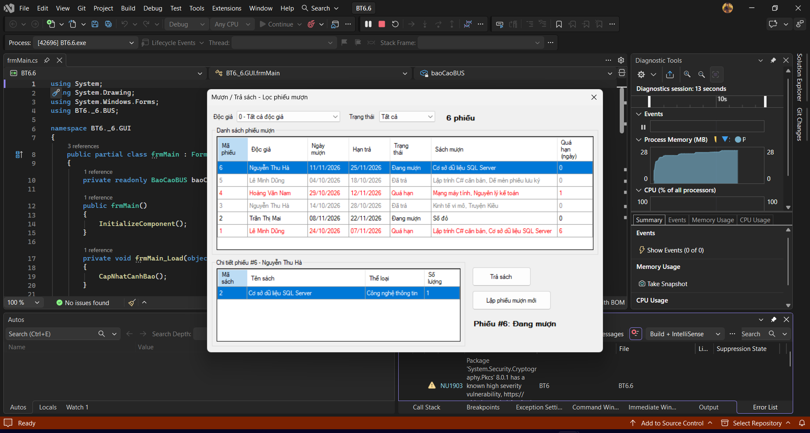
2. **Màn hình Quản lý Danh mục (CRUD - Thêm đầu sách):** 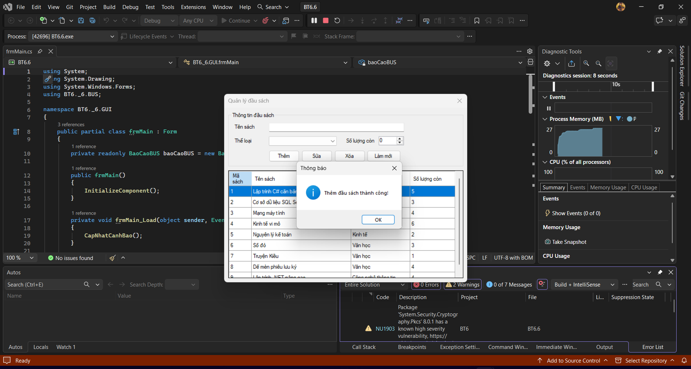
3. **Màn hình Thực thi Nghiệp vụ chính (Lọc "Quá hạn" & Trả sách):** 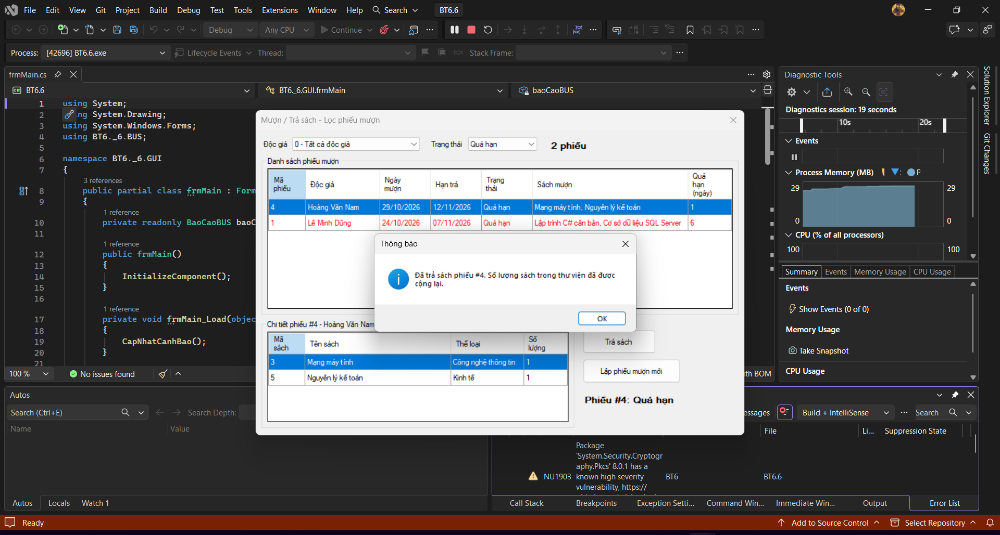
4. **Màn hình Báo cáo - Thống kê (Quá hạn & lượt mượn theo thể loại):** 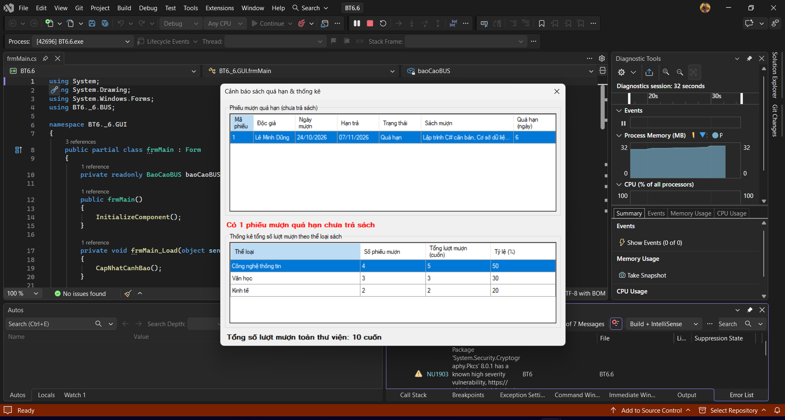
5. **Minh họa An toàn Dữ liệu (Chặn lập phiếu khi thẻ độc giả hết hạn):** 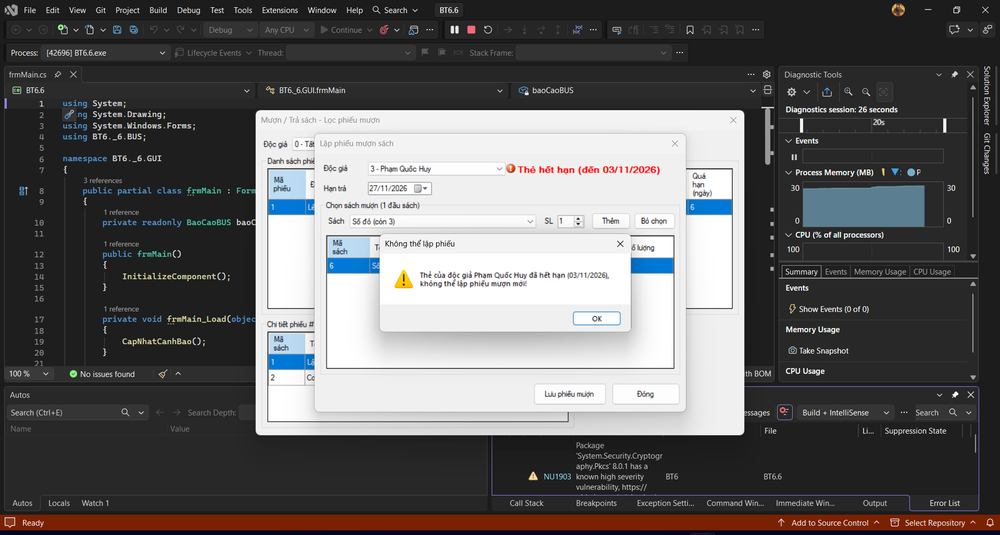

### BÀI 6.7 - QUẢN LÝ PHÒNG KHÁM & KÊ ĐƠN THUỐC (CLINIC & PHARMACY MANAGEMENT SYSTEM)

- Tiếp nhận: tra cứu bệnh nhân theo `SoDienThoai` bằng `SqlParameter`; bệnh nhân mới thì nhập thông tin và tạo `HoSoKham` (cùng 1 transaction). Quản lý danh mục thuốc: thêm thuốc mới, cập nhật đơn giá, nhập thêm tồn kho.
- **Kê đơn & xuất kho (SqlTransaction):** bác sĩ nhập chẩn đoán, chọn thuốc + số lượng + liều dùng; bấm "Lưu & Xuất đơn" → tạo `DonThuoc` → tạo `ChiTietDonThuoc` → trừ `SoLuongTon`; thuốc nào không đủ thì `trans.Rollback()` và cảnh báo.
- **Thanh toán & in hóa đơn:** Tổng chi phí = `TienKham` + Tổng (SoLuong × DonGia), chuyển đơn sang "Đã thanh toán"; in hóa đơn bằng `PrintDocument` + `PrintPreviewDialog`.

1. **Màn hình Chính / Tổng quan hệ thống (Tiếp nhận bệnh nhân):** 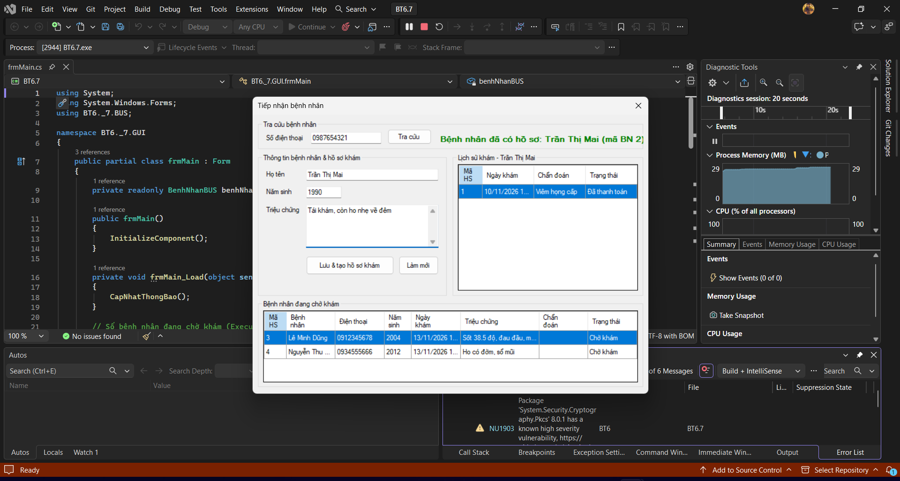
2. **Màn hình Quản lý Danh mục (CRUD danh mục thuốc):** 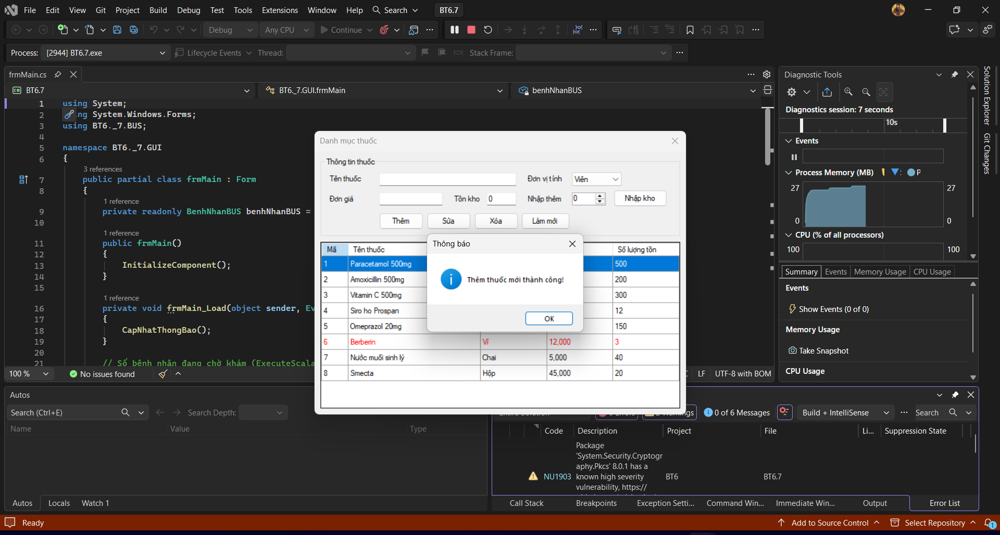
3. **Màn hình Thực thi Nghiệp vụ chính (Kê đơn - Lưu & Xuất đơn):** 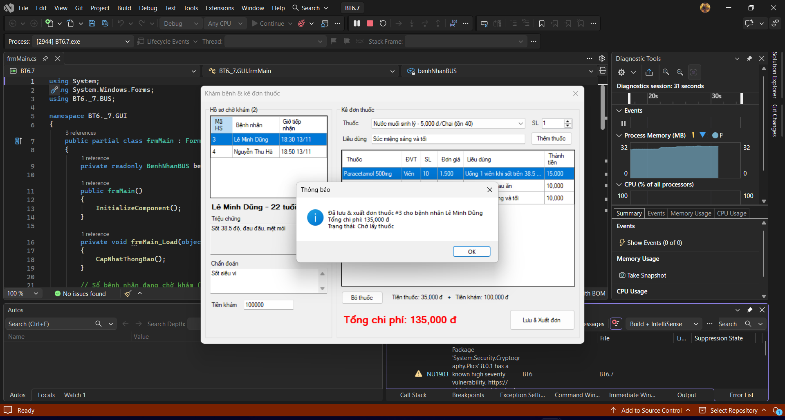
4. **Màn hình Báo cáo - Thống kê (Thanh toán & hóa đơn viện phí):** 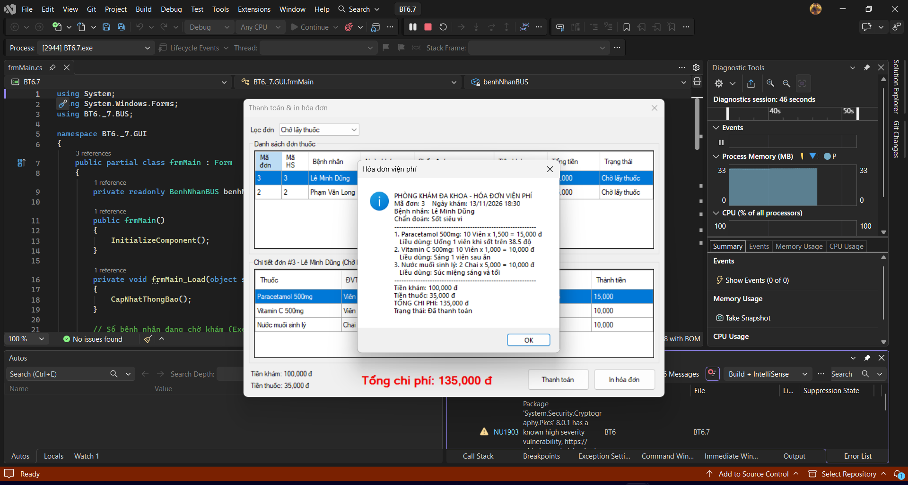
5. **Minh họa An toàn Dữ liệu (Rollback khi thiếu thuốc trong kho):** 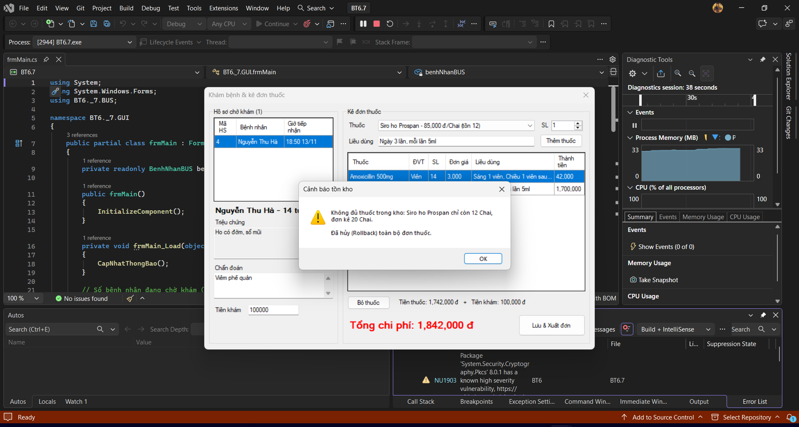

### BÀI 6.8 - QUẢN LÝ BÀN BIDA & DỊCH VỤ GIẢI TRÍ (BILLIARDS CLUB MANAGEMENT SYSTEM)

- **Sơ đồ bàn bida:** nút tạo động từ CSDL trong `FlowLayoutPanel`, bàn "Trống" màu xanh lá, "Đang chơi" màu cam. Chọn bàn trống → "Mở bàn" tạo `HoaDon` với `GioBatDau = GETDATE()`, bàn chuyển "Đang chơi".
- Tính giờ tự động bằng `Timer`; số giờ làm tròn theo **block 15 phút**, `TienGioChoi = Số giờ × GiaTheoGio`.
- **Gọi đồ uống / thuê phụ kiện (Disconnected Model):** món đã gọi nạp vào `DataTable` bằng `SqlDataAdapter`; gọi món mới hoặc sửa trực tiếp cột Số lượng trên `DataGridView` rồi đồng bộ bằng `SqlCommandBuilder` + `adapter.Update()`.
- **Thanh toán (SqlTransaction):** cập nhật `HoaDon` (GioKetThuc, TienGioChoi, TienDichVu, TrangThai = 1) → trừ `TonKho` (bỏ qua dịch vụ thuê gậy, `TonKho = NULL`) → bàn về "Trống" → `Commit`; kho không đủ thì `Rollback`.

1. **Màn hình Chính / Tổng quan hệ thống (Sơ đồ bàn):** 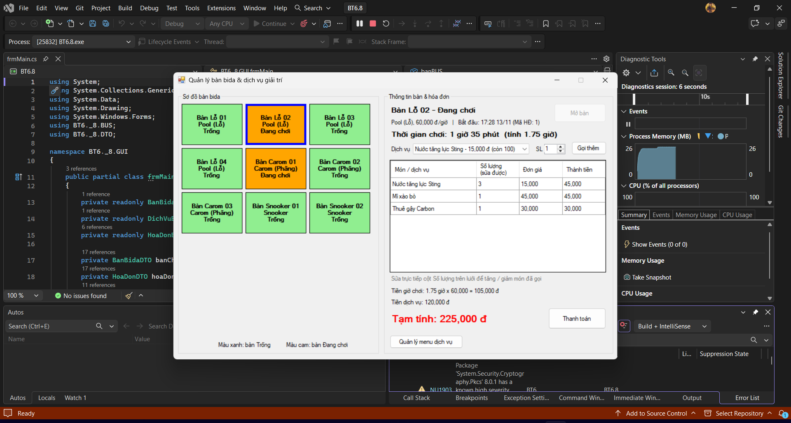
2. **Màn hình Quản lý Danh mục (CRUD menu dịch vụ):** 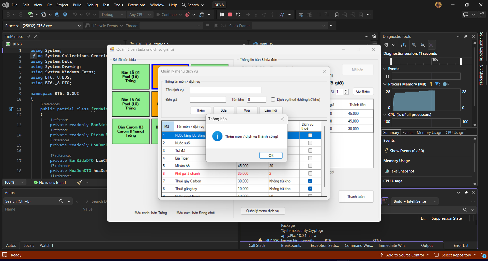
3. **Màn hình Thực thi Nghiệp vụ chính (Mở bàn & gọi món / thuê gậy):** 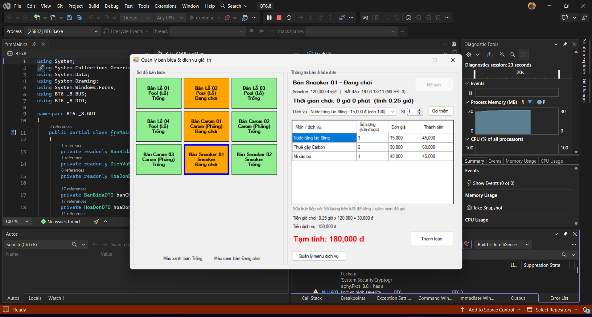
4. **Màn hình Báo cáo - Thống kê (Hóa đơn thanh toán):** 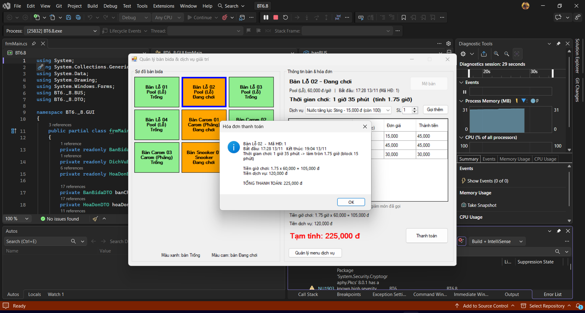
5. **Minh họa An toàn Dữ liệu (Rollback khi không đủ hàng trong kho):** 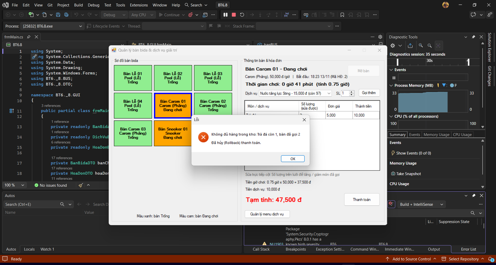

---

## MỤC 3: KẾT LUẬN

- Cả 3 bài tách rõ 4 lớp: GUI - BUS - DAL - DTO; giao diện dùng các control kéo từ Toolbox (`ErrorProvider`, `BindingSource`, `Timer`, `FlowLayoutPanel`, `PrintDocument`, `PrintPreviewDialog`...).
- Các nghiệp vụ quan trọng (lập phiếu mượn, trả sách, kê đơn xuất kho, mở bàn, thanh toán) đều dùng `SqlTransaction` để dữ liệu luôn toàn vẹn.
- Mọi truy vấn dùng `SqlParameter`, chống SQL Injection.
